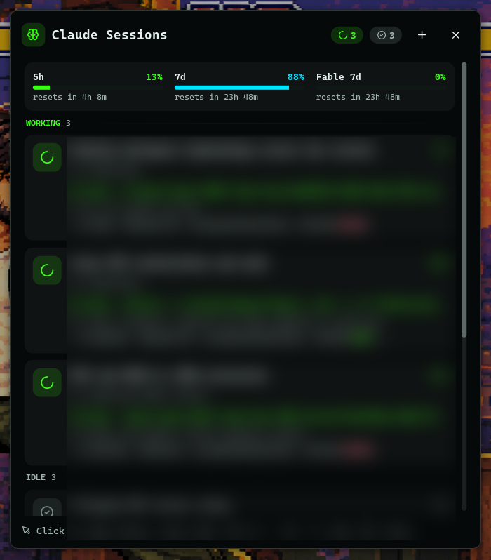
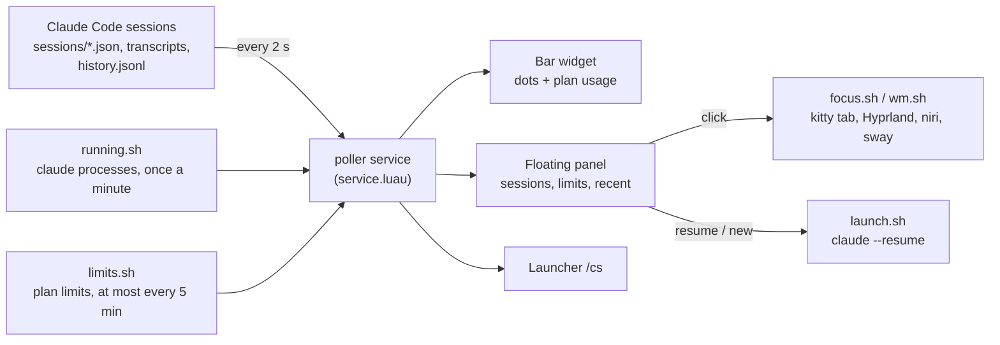

# AI usage widgets for the Noctalia bar

Three bar widgets for [Noctalia](https://github.com/noctalia-dev/noctalia) that show how much of your AI plans you have used, side by side:

| Plugin | ID | What it shows |
|---|---|---|
| [Claude Sessions](claude-sessions/README.md) | `hani/claude-sessions` | Every [Claude Code](https://claude.com/claude-code) session: which ones are working, which are waiting for you, what each is doing, and your Claude plan limits. A fork of [lfdominguez/claude-sessions](https://github.com/noctalia-dev/community-plugins/tree/main/claude-sessions) 1.5.2. |
| [Codex Usage](codex-usage/README.md) | `hani/codex-usage` | Your ChatGPT plan limits for Codex (5-hour and weekly windows) with reset countdowns, read through OpenCode's ChatGPT sign-in, and your open [OpenCode](https://opencode.ai) sessions on OpenAI models. |
| [Muse Usage](muse-usage/README.md) | `hani/muse-usage` | Your Muse Code plan limits (5-hour and weekly windows) with reset countdowns, and your open OpenCode sessions on Muse models. |

All three look the same on the bar: an icon, then a small meter per plan window. A click opens a floating panel.

OpenCode sessions show on the pill of their model's provider. Each widget has a `providers` setting, a pattern matched against the session's provider ID: `^openai$` for Codex Usage and `^muse$` for Muse Usage.




## Install

Add this repo as a plugin source and enable the plugins you want:

```sh
noctalia msg plugins source add ai-usage git https://github.com/h1n054ur/noctalia-ai-usage
noctalia msg plugins enable hani/claude-sessions
noctalia msg plugins enable hani/codex-usage
noctalia msg plugins enable hani/muse-usage
```

Then put the widgets on a bar in `~/.config/noctalia/config.toml`:

```toml
[widget.claude]
type = "hani/claude-sessions:bar"

[widget.codex]
type = "hani/codex-usage:bar"

[widget.muse]
type = "hani/muse-usage:bar"

[bar.default]
start = [ "workspaces", "claude", "codex", "muse" ]
```

You can enable any of them on its own. If you used the community Claude plugin before, disable it with `noctalia msg plugins disable lfdominguez/claude-sessions`.

For a local copy you can edit, clone the repo and link the plugin folders into `~/.local/share/noctalia/plugins/`, where Noctalia picks them up as local plugins:

```sh
git clone https://github.com/h1n054ur/noctalia-ai-usage
ln -s "$PWD/noctalia-ai-usage/claude-sessions" ~/.local/share/noctalia/plugins/claude-sessions
ln -s "$PWD/noctalia-ai-usage/codex-usage" ~/.local/share/noctalia/plugins/codex-usage
ln -s "$PWD/noctalia-ai-usage/muse-usage" ~/.local/share/noctalia/plugins/muse-usage
```

Codex Usage needs OpenCode signed in to ChatGPT with the Codex browser method (`opencode auth login openai --method chatgpt-browser`), plus `sqlite3`, `jq` and `curl`. Its [README](codex-usage/README.md) explains why the default sign-in is not enough.

Muse Usage needs a Muse Code subscription, the `muse` CLI signed in with `muse login`, and OpenCode with the [open-muse](https://github.com/jaylamping/open-muse) plugin, which adds Muse as the OpenCode provider `muse`. Its [README](muse-usage/README.md) has the details, including why the limits often stay empty until Muse reports usage.

## Claude Sessions

Every Claude Code session at a glance: which ones are working, which are waiting for you, what each is doing right now, and how much of your plan is left. Click a session to jump straight to its terminal, down to the exact kitty tab. The main change from upstream is a panel that floats as its own card, so it works with transparent and floating bars.

### What it shows

- Sessions that need you jump to the top, turn the bar icon into a red bell and send a desktop notification.
- What each session is doing: the tool it's running, todo progress, your last prompt, model, permission mode, context size and estimated cost.
- Plan limits: 5-hour, 7-day and per-model weekly usage with reset countdowns.
- Jump to the terminal: click a session to focus its window. On kitty it lands on the exact tab or split.
- Resume and start sessions: reopen recently closed sessions, or start a new one in a recent project.
- Keyboard and launcher: move through the panel with the keyboard, or search sessions from the launcher with `/cs`.
- Several accounts: sessions with different `CLAUDE_CONFIG_DIR`s are grouped per account, each with its own limits.
- Works on Hyprland, niri and sway.

### Changes in this fork

| | Upstream 1.5.2 | This fork |
|---|---|---|
| Panel placement | Attached to the bar, using the bar's background | Floating card with its own background, border and shadow |
| Plugin ID | `lfdominguez/claude-sessions` | `hani/claude-sessions`, so both can be installed side by side |
| Accent colour | Theme primary | Claude's coral (`#D97757`), set with `accent_color` |
| Updates | Community source | This repo, as its own Noctalia plugin source |

With an attached panel and a transparent bar (`background_opacity = 0`), the panel has nothing behind it and its content floats over your windows. A floating panel brings its own card, which also suits floating or pill-style bars.

### How it works



Everything is read locally from Claude Code's own files. The only network call is the optional plan-limits request, made with each account's own token, which is passed to `curl` on stdin and never written anywhere. The plugin's [README](claude-sessions/README.md#notes) lists every file it reads and every command it runs.

### Requirements

Claude Code 2.1 or newer, `jq`, `curl` and `xdg-open`, plus `hyprctl`, `niri` or `swaymsg` for focusing windows. kitty with remote control gives exact tab focusing; the plugin's README explains the two `kitty.conf` lines.

The full guide is in [claude-sessions/README.md](claude-sessions/README.md): bar styles, the panel and its keyboard shortcuts, several accounts, the launcher, every setting, IPC commands, privacy notes and troubleshooting.

## Credits and licence

Claude Sessions was written by [lfdominguez](https://github.com/lfdominguez) and published in [noctalia-dev/community-plugins](https://github.com/noctalia-dev/community-plugins) under the MIT licence. This fork keeps that licence and the credit. Codex Usage and Muse Usage are new work under the same MIT licence. See [LICENSE](LICENSE). The screenshots in `claude-sessions/images` are from the original plugin.
