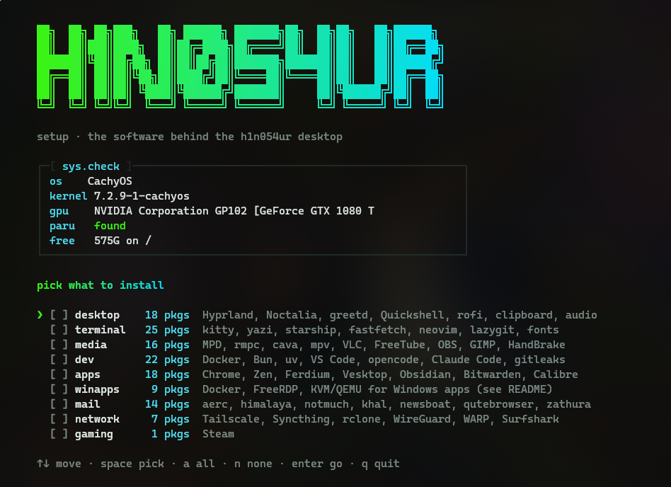
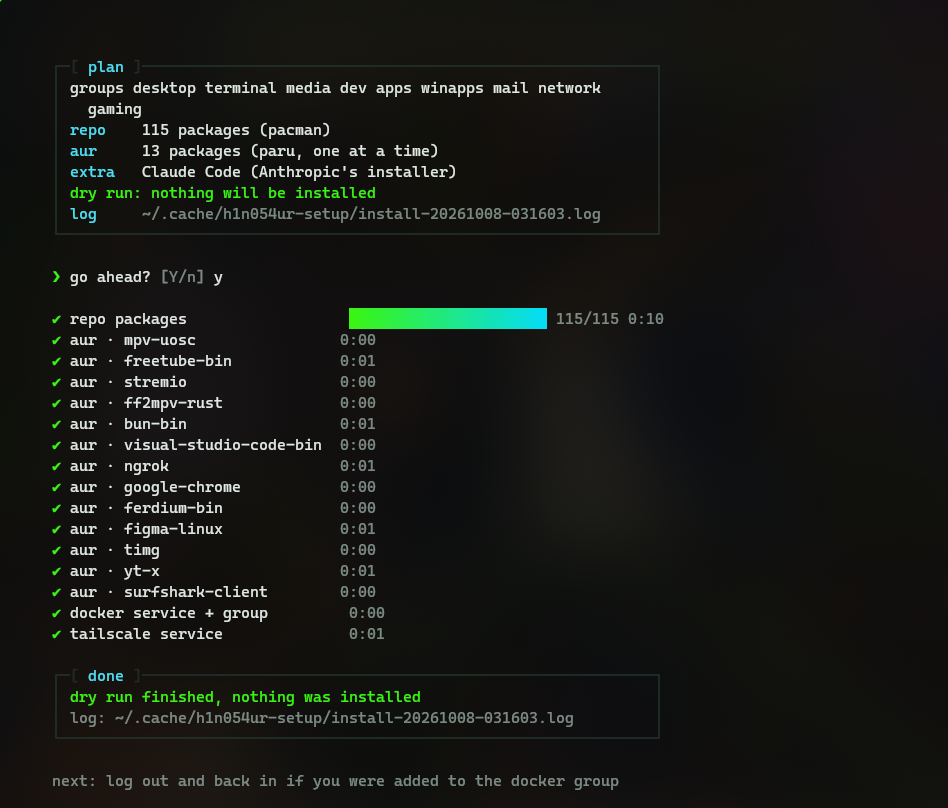

# h1n054ur setup

The software behind my desktop: CachyOS with Hyprland and the Noctalia shell, with my apps arranged into installable groups. The look itself lives in the other repos of [h1n054ur/desktop](https://github.com/h1n054ur/desktop).

## 1. CachyOS

Install [CachyOS](https://cachyos.org) and pick the **Hyprland** desktop in the installer (its Noctalia edition). On NVIDIA, CachyOS' hardware tool (`chwd`) picks the right driver; older Pascal cards (GTX 10xx) need the 580xx series. After the first boot:

```sh
git clone https://github.com/h1n054ur/h1n054ur-setup ~/h1n054ur-setup
cd ~/h1n054ur-setup
./install.sh                          # interactive: pick groups, see the plan, watch it install
./install.sh desktop terminal --yes   # no questions, for scripts
./install.sh --profile laptop         # desktop groups plus voice tools
./install.sh --dry-run                # the whole walk-through without installing anything
```

The interactive run starts with the H1N054UR banner and a system check (OS, kernel, GPU, paru, free space), then a checklist of groups: arrow keys to move, Space to pick, `a` for all, Enter to go. A plan box shows what will happen before anything does. Sudo is asked for once. Each step gets a spinner, a progress bar fed by pacman's own `(n/m)` counter and the elapsed time; the full output goes to `~/.cache/h1n054ur-setup/`.

| Pick the groups | Watch it run |
|---|---|
|  |  |

## 2. The groups

| Group | What you get |
|---|---|
| `desktop` | Hyprland and its idle, lock, wallpaper and polkit helpers, Noctalia and its greeter, greetd, Quickshell, the fuzzel launcher, rofi, clipboard history, audio and Bluetooth controls |
| `terminal` | kitty, yazi, starship, fastfetch, zoxide, ripgrep, fd, fzf, bat, eza, btop, glances, neovim, micro, lazygit, lazydocker, the Nerd and Noto fonts |
| `media` | MPD, rmpc and cava for music; mpv with uosc, yt-dlp, FreeTube, Stremio, the Jellyfin mpv shim; HandBrake, OBS, GIMP, Avidemux |
| `dev` | git, GitHub CLI, Docker (with Compose, Buildx and the NVIDIA toolkit), Bun, uv, nvm, rbenv, VSCodium, opencode, CMake, Ninja, ShellCheck, Caddy, cloudflared, ngrok, DBeaver, MySQL Workbench, Meld, gitleaks, and **Claude Code** (Anthropic's own installer, which keeps itself up to date) |
| `apps` | Helium (vertical tabs), Vesktop, Obsidian, Bitwarden with rbw and rofi-rbw, Calibre, Foliate, TeamSpeak, Figma, FileZilla, Remmina, Mission Center, Dolphin, Kate, Gwenview |
| `voice` | uv and Pocket TTS prerequisites, Handy offline dictation, jq, PulseAudio tools and wtype |
| `mail` | aerc, himalaya, isync, notmuch, khal, calcurse, newsboat, qutebrowser, w3m, zathura, timg, yt-x |
| `network` | Tailscale, Syncthing with its tray, rclone, WireGuard tools, Cloudflare WARP, Surfshark |
| `gaming` | Steam |

Repo packages install in one go; AUR packages build one at a time with paru, and a failed build is listed at the end instead of stopping the run.

`--profile laptop` adds `voice`. The desktop profile remains the default, and a host named `laptop` selects the laptop profile automatically.

## 3. Apps that start in the tray

Some apps open a window at login on whichever screen has focus. Two of them need a hand:

- **Bitwarden:** Settings, then turn on *Show tray icon* and *Start to tray icon*. It starts hidden; Super+P opens it.
- **Assistant (tap Right Ctrl):** [`bin/assistant`](bin/assistant) toggles a kitty quick-access panel (a quick Right Ctrl tap; it hides itself after each reply through a Stop hook) running Claude Code (Haiku) in [`assistant/`](assistant), whose `CLAUDE.md`, `desktop` skill (screens, every shortcut, place, Noctalia and media commands, apps, safety) and permissions let it drive the desktop through [`bin/place`](bin/place) (open or move apps on the left/right screen or a workspace). Link both into `~/.local/bin`. Talk to it by holding Right Alt (the dictation below).
- **Voice commands (fast path):** Handy's paste method is set to *external script* = [`bin/handy-out`](bin/handy-out). With the assistant panel open, it runs known commands itself ([`assistant/commands.json`](assistant/commands.json): media, volume, place app/window moves, workspaces, screenshot, toggles), picked by plain code or by **Laya**, a local decision model served by [colibri](https://github.com/JustVugg/colibri) (~0.4 s on the CPU, unit [`assistant/laya.service`](assistant/laya.service)); anything else goes to the panel. In a Claude Code window it types and sends; elsewhere it just types. `journalctl -t handy-out` shows every decision.
- **Handy (dictation):** Handy only has a toggle command on Wayland. [`bin/handy-ptt`](bin/handy-ptt) turns it into hold-to-talk on Right Alt (binds in [hyprland-h1n054ur](https://github.com/h1n054ur/hyprland-h1n054ur): it starts or stops only when Handy's real state (its PipeWire capture stream) needs it, so a missed key release can't leave it listening. Where the text goes is handy-out's job (above). Install it with `install -m 755 bin/handy-ptt ~/.local/bin/` (needs `jq` and `pactl`). In Handy, set Overlay Position to None and move its own shortcut off any key you use.
- **Surfshark:** its *Launch minimized* setting doesn't hide the window on Hyprland. [`bin/start-to-tray`](bin/start-to-tray) starts an app, waits for its first window and closes it, and the app keeps running in the tray. Copy it to `~/.local/bin` and point Surfshark's login entry at it:

```sh
install -m 755 bin/start-to-tray ~/.local/bin/
sed -i "s#^Exec=.*#Exec=$HOME/.local/bin/start-to-tray Surfshark /opt/Surfshark/surfshark#" ~/.config/autostart/surfshark.desktop
```

The first argument is the window class (`hyprctl clients` shows it), the rest is the command. It works for any app that keeps running when its window is closed.

## Part of h1n054ur/desktop

This repo is generated from the `setup/` folder of [h1n054ur/desktop](https://github.com/h1n054ur/desktop). It is read-only: open issues and pull requests there.

## Licence

MIT, see [LICENSE](LICENSE).
